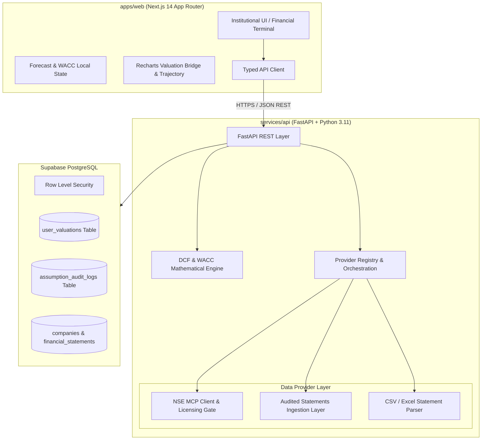

# System Architecture: QuantDCF India Valuation Platform

## 1. High-Level Overview

QuantDCF India is a production-grade institutional equity valuation platform built for Indian equities listed on the National Stock Exchange (NSE) and Bombay Stock Exchange (BSE). The platform strictly enforces **data traceability**, **licensing compliance**, and **mathematical rigor**.



---

## 2. Monorepo Structure

```text
dcf-valuation-platform/
├── apps/
│   └── web/                     # Next.js 14 (App Router), TypeScript, Tailwind CSS, Recharts
│       ├── src/
│       │   ├── app/             # Dashboard, Screener, Valuation [symbol], Saved, Reports, Sources, Settings
│       │   ├── components/      # UI components, layout, DCF tables, sensitivity heatmap, charts
│       │   └── lib/             # Formatters (INR / Crore / Lakh), API client, types
├── services/
│   └── api/                     # Python FastAPI backend
│       ├── app/
│       │   ├── engine/          # Pure, unit-tested DCF, WACC, sensitivity & scenario engines
│       │   ├── providers/       # NSE MCP client, Audited filings, CSV/XLSX parser
│       │   └── routers/         # REST APIs: companies, financials, valuation, sources, reports, saved
│       ├── main.py              # Application entrypoint with CORS & healthcheck
│       ├── requirements.txt     # Locked production dependencies
│       └── Dockerfile           # Optimized multi-stage container
├── packages/
│   └── shared/                  # Common TypeScript definitions & Indian macro constants
├── database/
│   └── migrations/              # Supabase SQL schema & Row Level Security (RLS) policies
├── tests/
│   └── backend/                 # Automated pytest suite (DCF engine, WACC, sensitivity, APIs)
├── docs/                        # Architecture, deployment, methodology & licensing documentation
├── .github/workflows/           # Automated CI testing & build pipeline
├── docker-compose.yml           # Unified local & containerized orchestration
├── .env.example                 # Documented environment variables template
└── README.md                    # Setup, execution & deployment guide
```

---

## 3. Data Ingestion & Provider Decoupling

The platform decouples data providers from calculation models using strict interfaces:

1. **`MarketDataProvider`**:
   - Fetches live quotes and market capitalization snapshots.
   - Adapter: `NSEMCPProvider` connecting to `https://mcp.nseindia.in/cmmkt/mcp`.
   - **Compliance Gate**: Controlled by `NSE_DATA_LICENSE_APPROVED`. If `false`, the provider remains locked with an explicit compliance notice, preventing unauthorized redistribution and never fabricating fake numbers.

2. **`FundamentalDataProvider`**:
   - Supplies audited historical balance sheets and profit & loss statements.
   - Sourced directly from audited annual reports and statutory filings filed with BSE/NSE.
   - Every line item records provenance (`AUDITED`), filing source, and timestamp.

3. **`DocumentExtractionProvider`**:
   - Normalizes user-uploaded `.csv` and `.xlsx` financial statements.
   - Maps revenue, operating expenses, EBIT, taxes, D&A, CapEx, NWC changes, debt, and cash balances into normalized schemas.

---

## 4. Security & Production Isolation

- **Secret Separation**: API keys, database connection strings, and service-role keys are kept strictly on the backend. No server secrets are ever prefixed with `NEXT_PUBLIC_`.
- **Row Level Security (RLS)**: User valuations and assumption override audit logs are protected in PostgreSQL using Supabase Auth claims (`auth.uid() = user_id`).
- **Input Validation**: All incoming requests are validated against strict Pydantic schemas. Invalid weights ($W_e + W_d \neq 100\%$) or invalid terminal growth rates ($WACC \le g$) are rejected with informative `422 Unprocessable Entity` responses.
